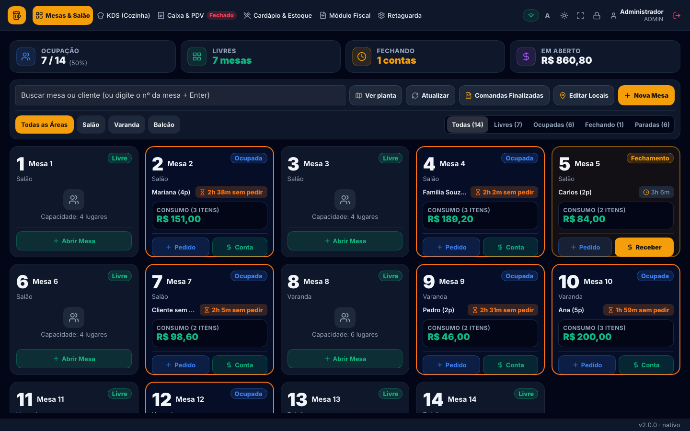
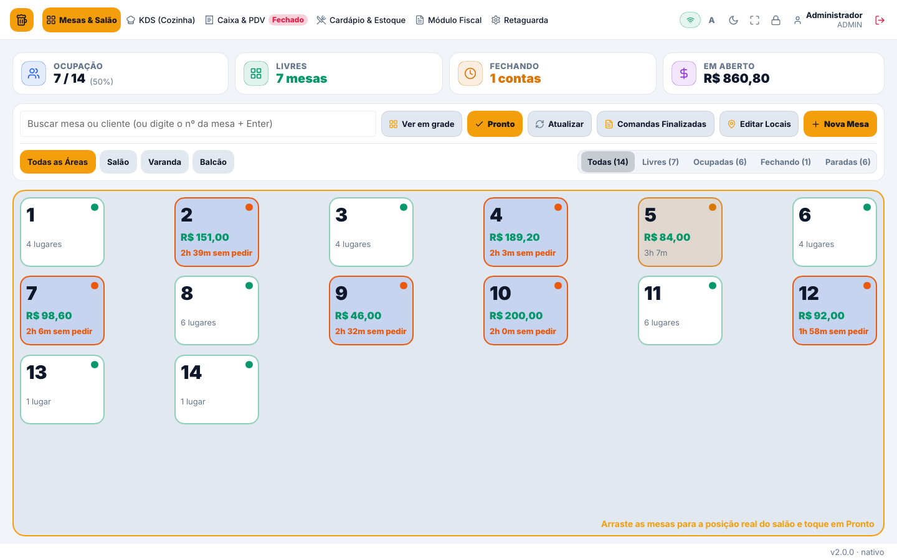
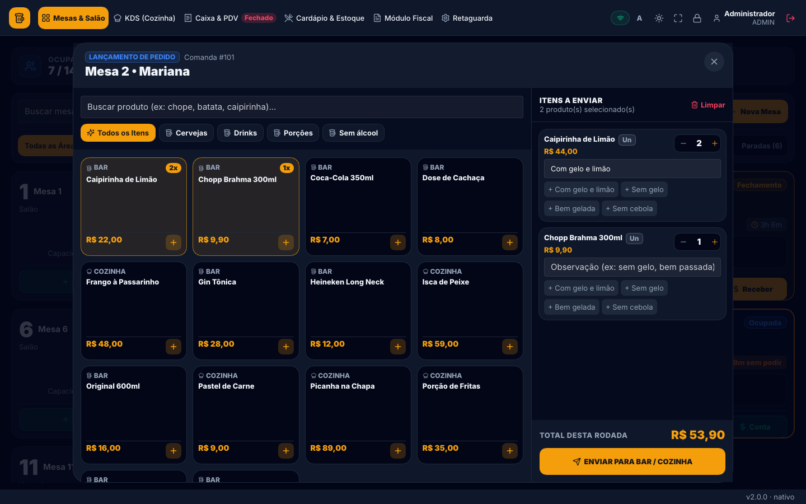
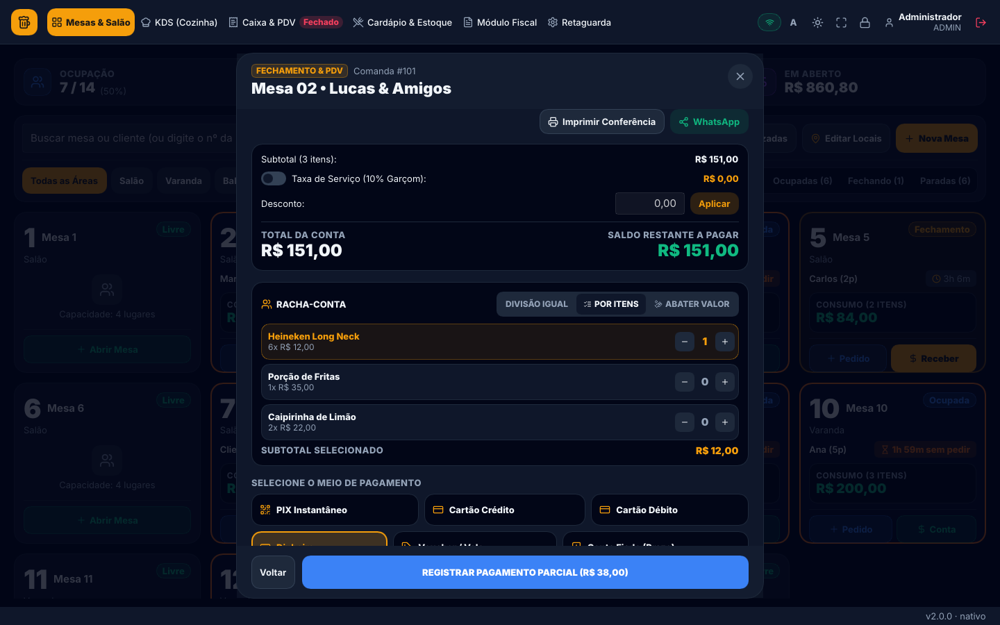
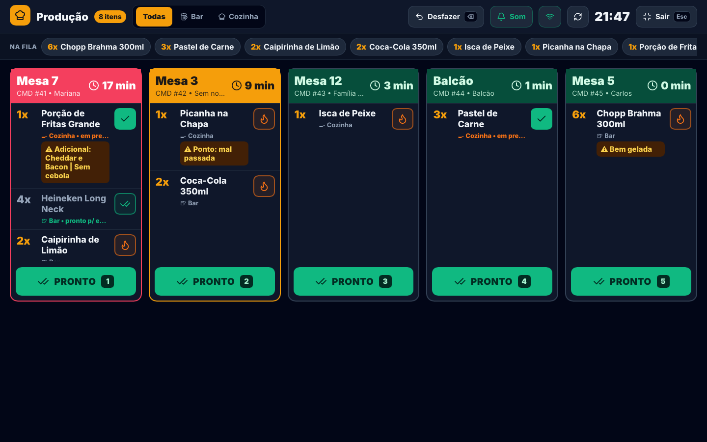
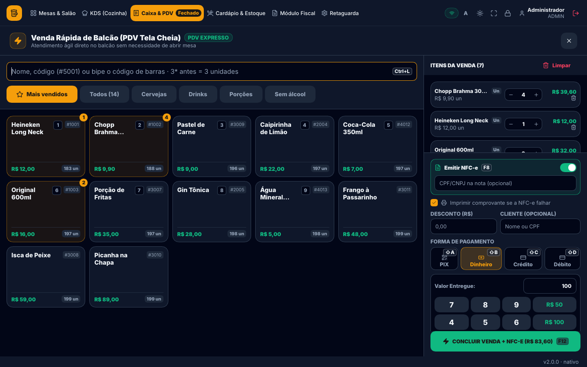
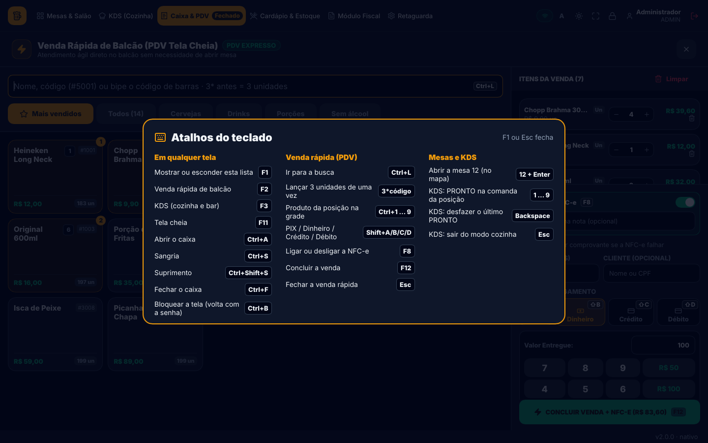
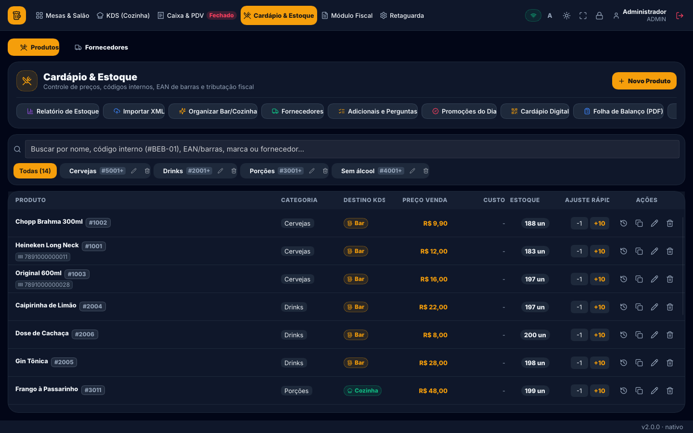
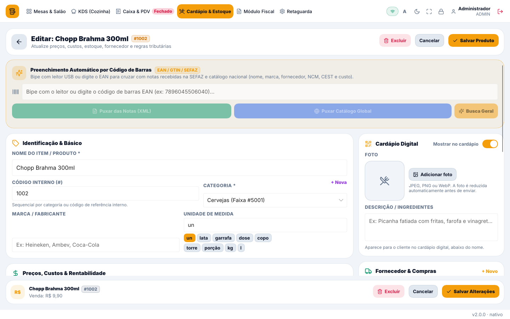
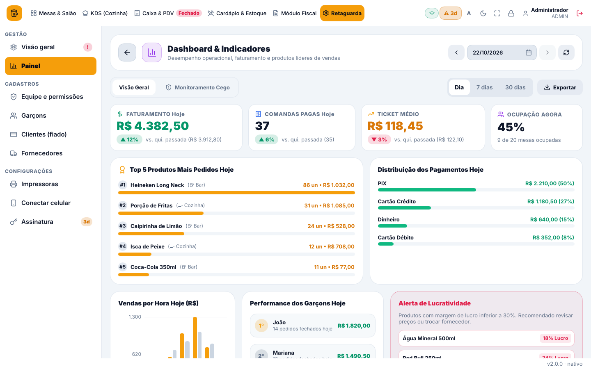

<div align="center">

# 🍺 BarERP Pro

### O sistema completo para bares e restaurantes — rápido, nativo e feito para o balcão

Mesas, comandas, cozinha, caixa, estoque e nota fiscal em um só app, que abre em segundos,<br>
funciona sem internet e conversa com os celulares dos garçons pelo Wi-Fi.




</div>

---

## ✨ Por que o BarERP Pro

| | |
|---|---|
| ⚡ **Rápido de verdade** | App nativo em Rust, sem navegador embutido: abre na hora e não trava no movimento. |
| 📶 **Funciona offline** | Tudo roda no computador do caixa. A internet só é usada para nota fiscal, cardápio digital e licença. |
| 📱 **Celulares no Wi-Fi** | Garçons lançam pedidos no celular e a cozinha recebe na tela. Conexão por QR Code, sem configurar nada. |
| 🧾 **Fiscal integrado** | NFC-e na venda, NF-e, cancelamento, inutilização e recebimento de notas de fornecedor. |
| 👆 **Feito para toque** | Letras grandes, botões de 44 px ou mais, tema claro e escuro, zoom de 100% a 140%. |
| ⌨️ **Feito para teclado** | Atalhos para tudo: aperte **F1** em qualquer tela para ver a lista. |

---

## 🍽️ Mesas & Salão

 

- **Mapa de mesas** com ocupação, mesas livres, contas fechando e total em aberto, filtrado por área e por status.
- **Planta do salão**: arraste as mesas para a posição real de cada ambiente.
- **Abra uma mesa digitando o número** e Enter, de qualquer lugar do mapa.
- **Mesas paradas**: a mesa ocupada há mais de 30 minutos sem pedir fica em laranja, para o garçom passar lá.
- **Lançamento de pedido** com busca, categorias, adicionais e perguntas obrigatórias, promoções do dia e observações rápidas ("sem gelo", "bem gelada").
- **Transferir e juntar mesas**, cancelar item (com estoque devolvido e auditoria) e registrar perda (calote).
- **Fechar conta** com divisão igual, por item ou por valor, haver parcial, taxa de serviço de 10%, desconto, fiado e envio da conferência por WhatsApp ou impressa.
- **Comandas finalizadas** para consultar e reimprimir.

<p align="center"></p>

---

## 👨‍🍳 KDS — Cozinha e Bar

<p align="center"></p>

- **Modo cozinha em tela cheia**, sem as abas do sistema, feito para ficar num monitor na cozinha ou no bar.
- **Cor pelo tempo de espera**: verde, âmbar a partir de 5 minutos e vermelho a partir de 15 minutos, com as comandas mais antigas primeiro.
- **"Na fila"**: o total de cada produto a preparar, para fazer em lote ("6x Chopp, 3x Pastel").
- **PRONTO em um toque** (ou nas teclas **1 a 9**), e **Desfazer** se tocou errado.
- **Aviso sonoro** quando chega pedido novo, e o garçom é avisado no celular quando o prato fica pronto.
- Filtro por praça (**Bar** ou **Cozinha**) e auto-impressão da comanda da cozinha.

---

## 💰 Caixa & PDV

<p align="center"></p>

- **Turno de caixa** com abertura, sangria, suprimento e **fechamento cego** com conferência (sobra ou falta).
- **Repasse dos 10%** de cada garçom no fim do expediente.
- **Venda rápida de balcão** (**F2**):
  - aba **Mais vendidos** com os produtos que mais saem, adicionados com **Ctrl+1…9**;
  - **leitor de código de barras** direto na busca, e `3*código` lança 3 unidades;
  - **teclado numérico na tela** para o valor entregue, com troco automático;
  - **NFC-e com CPF/CNPJ** (F8), comprovante térmico, desconto e cliente;
  - pagamento em PIX, dinheiro, crédito ou débito (**Shift+A/B/C/D**) e conclusão com **F12**.
- **Recebimentos por forma de pagamento** e todas as movimentações do turno.

<p align="center"></p>

---

## 📦 Cardápio & Estoque

 

- **Produtos** com código interno por categoria, EAN, marca, fornecedor, NCM/CFOP/CEST, venda por unidade ou **caixa fechada**.
- **Preenchimento automático pelo código de barras**: busca nas notas recebidas e no catálogo nacional.
- **Simulador de margem** (lucro, margem e markup) e **ficha técnica** (receitas que baixam os insumos).
- **Adicionais e perguntas**, **promoções do dia** por horário e dia da semana, histórico de preços.
- **Relatório de estoque**, **folha de balanço em PDF** e ajuste rápido de estoque.
- **Cardápio digital** publicado na internet, com fotos, descrições e **QR Codes das mesas em PDF**.
- **Fornecedores** e **clientes com fiado**, com pagamento do saldo devedor.

---

## 🧾 Módulo Fiscal

- **NFC-e** na venda do balcão, no fechamento de mesa e no emissor manual; o cupom sai na impressora térmica.
- **NF-e (modelo 55)** com busca de CEP e do cliente pelo CPF; o DANFE A4 sai em PDF.
- **Cancelamento, inutilização e reimpressão** de NFC-e e NF-e.
- **Recebimento de notas de fornecedor**: 1º e 2º bip da DANFE, importação de XML, notas pendentes e entrada no estoque vinculando produtos.
- **Painel do contador** e situação da SEFAZ em tempo real.

---

## 📊 Retaguarda & Gestão

<p align="center"></p>

- **Painel** com faturamento, comandas pagas, ticket médio e ocupação, **comparados com a semana anterior** (▲/▼).
- Visão do **dia, 7 dias ou 30 dias**, vendas por hora com escala, top 5 produtos, formas de pagamento, ranking de garçons e alerta de margem baixa. **Exporta em CSV** para o Excel.
- **Monitoramento cego**: auditoria de cancelamentos, descontos e perdas.
- **Equipe e permissões**: cada funcionário vê só as áreas liberadas; **bloqueio da tela** (Ctrl+B) com troca de operador pela senha.
- **Impressoras térmicas** (Epson, Bematech, Elgin, POS-80) por USB ou rede, com simulador da bobina.
- **Backup automático** ao abrir, a cada 6 horas e ao fechar o caixa, com cópia para a pasta do Google Drive ou OneDrive.
- **Atualização automática** com novidades da versão e barra de download.

---

## 📱 Celulares dos garçons e da cozinha

O app do caixa já é o servidor: os aplicativos **Garçom** e **Cozinha (KDS)** para Android se conectam pelo Wi-Fi do bar lendo um **QR Code** na tela. Pedidos, mesas, caixa e cozinha se atualizam na hora em todos os aparelhos, e o garçom pode pedir a impressão da conta direto do celular.

---

## ⌨️ Atalhos principais

| Tecla | Ação | Tecla | Ação |
|---|---|---|---|
| **F1** | Lista de atalhos | **F8** | Liga/desliga a NFC-e |
| **F2** | Venda rápida de balcão | **F12** | Concluir a venda |
| **F3** | KDS (cozinha) | **Ctrl+1…9** | Produto da grade no PDV |
| **F11** | Tela cheia | **12 + Enter** | Abrir a mesa 12 |
| **Ctrl+A** | Abrir o caixa | **1…9** (KDS) | PRONTO na comanda |
| **Ctrl+S** | Sangria | **Backspace** (KDS) | Desfazer o último PRONTO |
| **Ctrl+Shift+S** | Suprimento | **Ctrl+B** | Bloquear a tela |
| **Ctrl+F** | Fechar o caixa | **Esc** | Fechar janela / sair do modo cozinha |

---

## 🛠️ Para desenvolvedores

```bash
source "$HOME/.cargo/env"
cargo test --workspace                 # testes
cargo run -p barerp-app                # abre o app (banco em %APPDATA% ou BARERP_DB=<arquivo>)
cargo run -p barerp-db --example demo_db -- demo.db                     # banco de demonstração
cargo run -p barerp-app --example mesas_shots -- demo.db prints/        # prints das telas sem abrir janela
```

O app é dividido em crates (`barerp-core`, `barerp-db`, `barerp-app`, `barerp-server`, `barerp-fiscal`, `barerp-print` e outros). Decisões de projeto, regras de trabalho, armadilhas conhecidas e o roteiro até a troca do sistema antigo estão em **[docs/DESENVOLVIMENTO.md](docs/DESENVOLVIMENTO.md)**.

<div align="center">

<sub>Interface feita com <a href="https://slint.dev">Slint</a> · Ícones <a href="https://lucide.dev">Lucide</a> · Made with Slint</sub>

</div>
